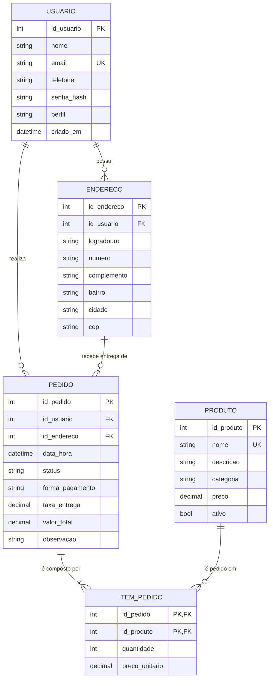

# Projeto de Banco de Dados — Pizzaria Delivery

SGBD: **PostgreSQL 14+** (popular, com boa documentação, fácil manutenção e oferecido gratuitamente em serviços de hospedagem).

---

## 1. Projeto conceitual (Modelo Entidade-Relacionamento)



### Cardinalidades
- Um **usuário** possui zero ou muitos **endereços** e realiza zero ou muitos **pedidos**.
- Um **endereço** pertence a um único usuário e pode receber vários pedidos.
- Um **pedido** tem um único cliente, um único endereço de entrega e **um ou mais** itens.
- **Pedido ↔ Produto** é N:N (um pedido tem vários produtos e um produto aparece em vários pedidos), resolvido pela tabela associativa `item_pedido`, que também guarda a quantidade e o preço da compra.

---

## 2. Projeto lógico (esquemas relacionais normalizados)

Notação: chave primária em primeiro lugar na lista; `#` = chave estrangeira.

```
usuario(id_usuario, nome, email, telefone, senha_hash, perfil, criado_em)

endereco(id_endereco, #id_usuario, logradouro, numero, complemento, bairro, cidade, cep)

produto(id_produto, nome, descricao, categoria, preco, ativo)

pedido(id_pedido, #id_usuario, #id_endereco, data_hora, status, forma_pagamento,
       taxa_entrega, valor_total, observacao)

item_pedido(#id_pedido, #id_produto, quantidade, preco_unitario)
```

### Chaves estrangeiras

| Tabela | Coluna | Referencia | Ação ao excluir |
|--------|--------|------------|-----------------|
| endereco | id_usuario | usuario | CASCADE |
| pedido | id_usuario | usuario | RESTRICT (padrão) |
| pedido | id_endereco | endereco | RESTRICT (padrão) |
| item_pedido | id_pedido | pedido | CASCADE |
| item_pedido | id_produto | produto | RESTRICT (padrão) |

Na prática, produtos são **inativados** (`ativo = FALSE`) em vez de excluídos, para preservar o histórico dos pedidos.

### Justificativa da normalização

- **1FN:** todos os atributos são atômicos. Os itens de um pedido não ficam em uma lista dentro de `pedido`; ficam em `item_pedido`. O endereço foi decomposto em logradouro, número, bairro, cidade e CEP.
- **2FN:** em `item_pedido`, `quantidade` e `preco_unitario` dependem da chave composta inteira (`id_pedido`, `id_produto`), pois descrevem o produto *naquele* pedido. Nas demais tabelas a chave primária é simples.
- **3FN:** não há dependências transitivas. Nome, descrição e categoria dependem só de `id_produto`; os dados do endereço dependem só de `id_endereco` (por isso a tabela separada). O pedido guarda apenas chaves para cliente e endereço, sem copiar seus dados.
- **Decisão consciente 1:** `preco_unitario` fica em `item_pedido` mesmo existindo `produto.preco`. São informações diferentes: o preço do cardápio hoje e o preço cobrado naquela compra. Sem isso, mudar o preço alteraria pedidos antigos.
- **Decisão consciente 2:** `valor_total` é um dado derivado (soma dos itens + taxa). Ele é gravado no momento do pedido como registro do valor cobrado, e a aplicação calcula e confere o total antes de gravar (RN05).

---

## 3. Projeto físico

O script completo está em [`../banco/schema.sql`](../banco/schema.sql). Principais decisões:

| Decisão | Motivo |
|---------|--------|
| Chaves `GENERATED ALWAYS AS IDENTITY` | Geração automática e segura dos identificadores |
| `senha_hash VARCHAR(255)` | Comporta os hashes gerados pelo `werkzeug.security` |
| Domínios com `CHECK` (perfil, categoria, status, pagamento, quantidade, preço, CEP) | Só dados válidos entram nas tabelas |
| `UNIQUE (email)` e `UNIQUE (nome)` em produto | Regra RN09 e cardápio sem duplicidade |
| `CHAR(8)` com `CHECK` por expressão regular para o CEP | Garante 8 dígitos numéricos |
| PK composta `(id_pedido, id_produto)` em `item_pedido` | Impede o mesmo produto repetido no pedido; a quantidade cobre o caso |
| `ON DELETE CASCADE` em `item_pedido` e `endereco` | Itens e endereços não existem sem o pedido/usuário |
| Índices em `pedido (id_usuario, data_hora DESC)` e `pedido (status, data_hora)` | Aceleram "Meus pedidos" e o painel da administração |
| Índice parcial em `produto (categoria) WHERE ativo` | Acelera o cardápio, que só mostra produtos ativos |

---

## 4. Consultas principais

```sql
-- Cardápio por categoria
SELECT id_produto, nome, descricao, preco
FROM produto
WHERE ativo AND categoria = %s
ORDER BY nome;

-- Meus pedidos
SELECT id_pedido, data_hora, status, forma_pagamento, valor_total
FROM pedido
WHERE id_usuario = %s
ORDER BY data_hora DESC;

-- Itens de um pedido
SELECT p.nome, i.quantidade, i.preco_unitario,
       i.quantidade * i.preco_unitario AS subtotal
FROM item_pedido i
JOIN produto p ON p.id_produto = i.id_produto
WHERE i.id_pedido = %s;

-- Painel da administração: pedidos do dia por status
SELECT pe.id_pedido, pe.data_hora, pe.status, u.nome AS cliente, u.telefone,
       e.logradouro, e.numero, e.bairro, pe.valor_total
FROM pedido pe
JOIN usuario u  ON u.id_usuario  = pe.id_usuario
JOIN endereco e ON e.id_endereco = pe.id_endereco
WHERE pe.data_hora::date = %s AND pe.status = %s
ORDER BY pe.data_hora;

-- Faturamento do dia (pedidos não cancelados)
SELECT COALESCE(SUM(valor_total), 0) AS faturamento
FROM pedido
WHERE data_hora::date = %s AND status <> 'CANCELADO';
```
