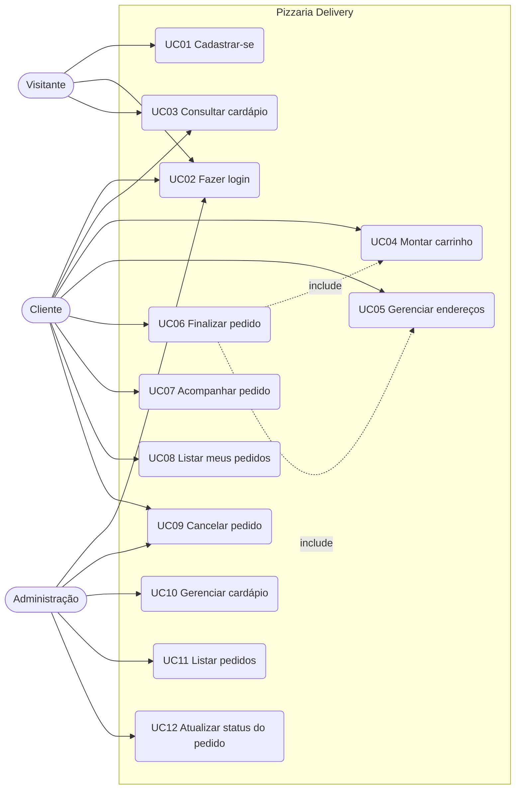
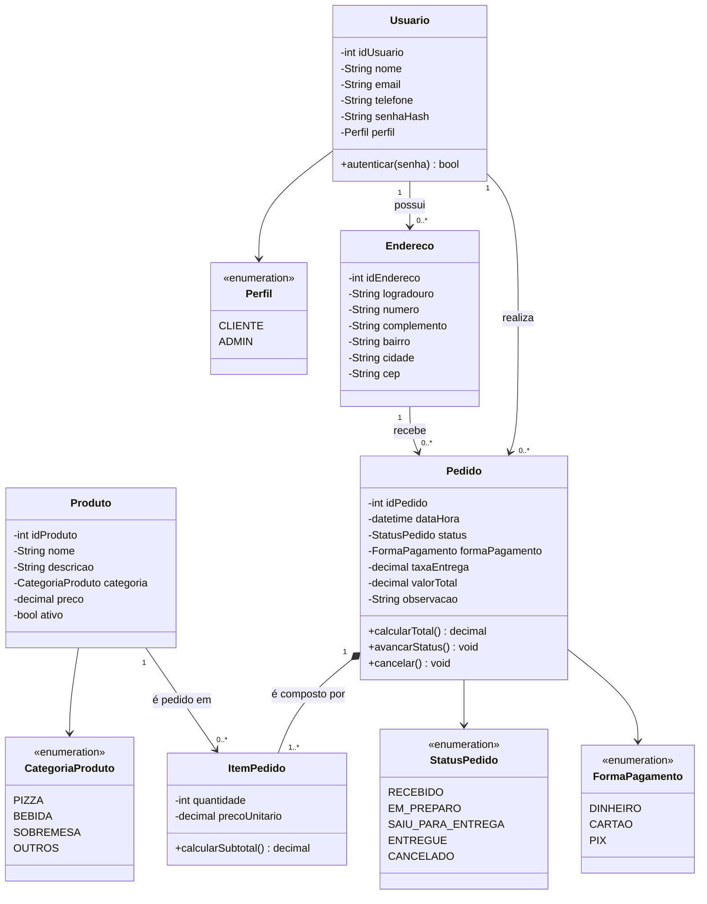
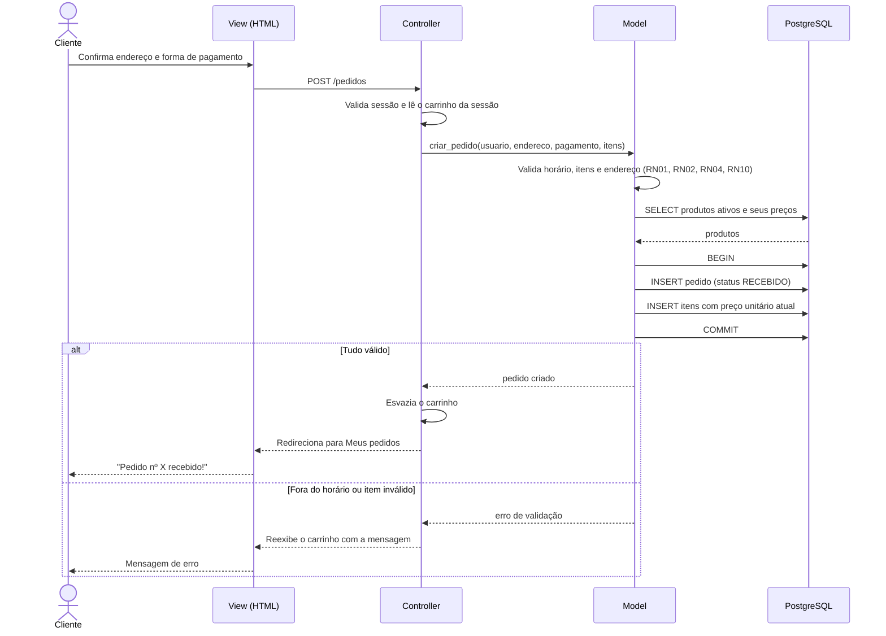
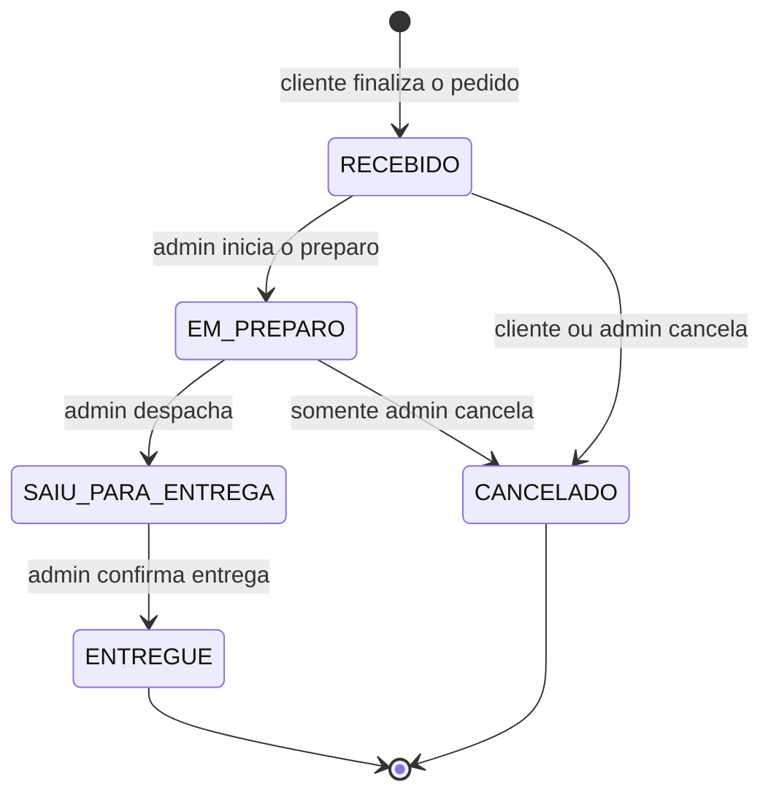
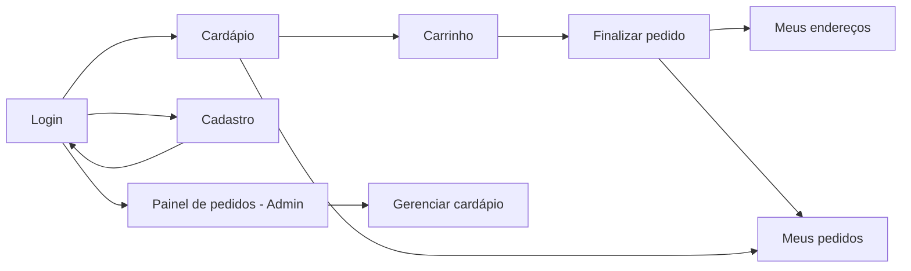

# Modelagem UML — Pizzaria Delivery

Os diagramas usam Mermaid e são renderizados automaticamente pelo GitHub.
Se o professor pedir imagens, abra este arquivo no GitHub, tire um print de cada diagrama e salve em `docs/img/`.

---

## 1. Diagrama de Casos de Uso

### Caso de uso expandido — UC06 Finalizar pedido

| Item | Descrição |
|------|-----------|
| Ator | Cliente |
| Pré-condição | Cliente autenticado, com pelo menos um item no carrinho |
| Fluxo principal | 1. Cliente abre o carrinho e clica em "Finalizar". 2. Sistema mostra o resumo com itens, taxa e total. 3. Cliente escolhe o endereço de entrega. 4. Cliente escolhe a forma de pagamento. 5. Cliente confirma. 6. Sistema valida horário e disponibilidade dos itens. 7. Sistema grava o pedido com status RECEBIDO e esvazia o carrinho. 8. Sistema exibe a confirmação com o número do pedido. |
| Fluxo alternativo A | No passo 6, a pizzaria está fechada: o sistema informa o horário de funcionamento e mantém o carrinho. |
| Fluxo alternativo B | No passo 6, algum item está inativo: o sistema remove o item, avisa e pede nova confirmação. |
| Fluxo alternativo C | No passo 3, o cliente não tem endereço: o sistema abre o cadastro de endereço. |
| Pós-condição | Pedido e itens gravados; status RECEBIDO |
| Regras | RN01 a RN06 e RN10 |

---

## 2. Diagrama de Classes

---

## 3. Diagrama de Sequência — Finalizar pedido

---

## 4. Diagrama de Estados — Pedido

---

## 5. Mapa de navegação (apoio à IHC)

